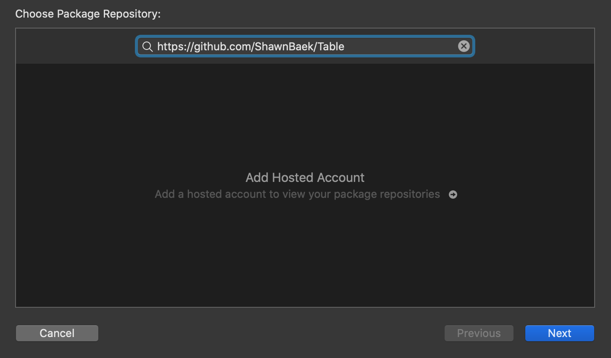
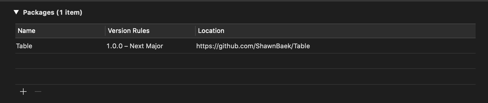
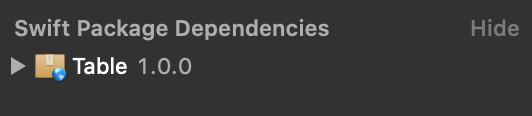

   

# Table

Swift library for beautifully formatted table output — supports Unicode, CJK, emoji, and `os.Logger`.

You can print the table bypassing the Any data!
[e.g., `1d array`,` 2d array`, and `dictionary`]

It inspired by `javascript` `console.table`.

I'm sure if you practice coding interviews, it helps you a lot. You don't need to struggle for checking results using a build-in print function!

## Requirements

- **Swift 6.1+** (Xcode 16+ or Swift 6.1 toolchain on Linux)
- macOS 11+ / iOS 14+ / tvOS 14+ / watchOS 7+

## Usage

```swift
import Table
//1D Array of String with Header
print(table: ["Good", "Very Good", "Happy", "Cool!"], header: ["Wed", "Thu", "Fri", "Sat"])

//1D Array of Int
print(table: [2, 94231, 241245125125])

//1D Array of Double
print(table: [2.0, 931, 214.24124])

//2D Array of String
print(table: [["1", "HELLOW"], ["2", "WOLLEH"]], header: ["Index", "Words"])

//2D Array of String, but Length is not equal!
print(table: [["1", "b2"], ["Hellow", "Great!"], ["sdjfklsjdfklsadf", "dsf", "1"]])

//2D Array of Int, but Length is not equal!
print(table: [[1, 2, 3], [4, 5, 6], [7, 8, 9, 10]])

//D.I.C.T.I.O.N.A.R.Y!!
print(table: ["1": 1, 2: "Hellow?", 1.2: 0, "I'm Table": [1, 2, 3, 2, 1]], header: ["key", "value"])
```

```swift
+------+-----------+-------+-------+
| Wed  | Thu       | Fri   | Sat   |
+------+-----------+-------+-------+
| Good | Very Good | Happy | Cool! |
+------+-----------+-------+-------+

+---+-------+--------------+
| 2 | 94231 | 241245125125 |
+---+-------+--------------+

+-----+-------+-----------+
| 2.0 | 931.0 | 214.24124 |
+-----+-------+-----------+

+-------+--------+
| Index | Words  |
+-------+--------+
| 1     | HELLOW |
| 2     | WOLLEH |
+-------+--------+

+------------------+--------+---+
| 1                | b2     |   |
| Hellow           | Great! |   |
| sdjfklsjdfklsadf | dsf    | 1 |
+------------------+--------+---+

+---+---+---+----+
| 1 | 2 | 3 |    |
| 4 | 5 | 6 |    |
| 7 | 8 | 9 | 10 |
+---+---+---+----+

+-----------+-----------------+
| key       | value           |
+-----------+-----------------+
| 2         | Hellow?         |
| I'm Table | [1, 2, 3, 2, 1] |
| 1.2       | 0               |
| 1         | 1               |
+-----------+-----------------+

```

## Support Distribution
The default distribution is `fillProportionally`.

```swift
print(table: ["Good", "Very Good", "Happy", "Cool!"], header: ["Wed", "Thu", "Fri", "Sat"])
```
```swift
+------+-----------+-------+-------+
| Wed  | Thu       | Fri   | Sat   |
+------+-----------+-------+-------+
| Good | Very Good | Happy | Cool! |
+------+-----------+-------+-------+
```

But It can be set by `fillEqually` like below

```swift
print(
    table: ["Good", "Very Good", "Happy", "Cool!"], 
    header: ["Wed", "Thu", "Fri", "Sat"], 
    distribution: .fillEqually
)
```
```swift
+-----------+-----------+-----------+-----------+
| Wed       | Thu       | Fri       | Sat       |
+-----------+-----------+-----------+-----------+
| Good      | Very Good | Happy     | Cool!     |
+-----------+-----------+-----------+-----------+
```

## SPM Support

The table is only supported SPM (Swift Package Management)






## Table Style

Choose between ASCII (default) or Unicode box-drawing characters:

### ASCII Style (Default)
```swift
print(table: [["1", "Hello"], ["2", "World"]], header: ["ID", "Word"])
```
```
+----+-------+
| ID | Word  |
+----+-------+
| 1  | Hello |
| 2  | World |
+----+-------+
```

### Unicode Style (MySQL-like)
```swift
print(table: [["1", "Hello"], ["2", "World"]], header: ["ID", "Word"], style: .unicode)
```
```
┌────┬───────┐
│ ID │ Word  │
├────┼───────┤
│ 1  │ Hello │
│ 2  │ World │
└────┴───────┘
```

## Multi-Language Support

Table correctly handles CJK characters, Korean Hangul, Japanese Kana, Arabic, and emoji with proper column alignment:

```swift
// Mixed language table with Unicode style
print(table: [
    ["Hello", "你好", "안녕하세요"],
    ["World", "世界", "반갑습니다"]
], header: ["EN", "CN", "Korean"], style: .unicode)
```
```
┌───────┬──────┬────────────┐
│ EN    │ CN   │ Korean     │
├───────┼──────┼────────────┤
│ Hello │ 你好 │ 안녕하세요 │
│ World │ 世界 │ 반갑습니다 │
└───────┴──────┴────────────┘
```

Multiple languages can also be mixed within the same value:

```swift
print(table: [
    ["안녕 Hello", "KR + EN"],
    ["你好 Hello", "CN + EN"],
    ["你好 안녕", "CN + KR"]
], header: ["Value", "Pair"], style: .unicode)
```
```
┌────────────┬─────────┐
│ Value      │ Pair    │
├────────────┼─────────┤
│ 안녕 Hello │ KR + EN │
│ 你好 Hello │ CN + EN │
│ 你好 안녕  │ CN + KR │
└────────────┴─────────┘
```

### Emoji Support

```swift
print(table: ["👋", "🎉", "🚀"], style: .unicode)
```
```
┌────┬────┬────┐
│ 👋 │ 🎉 │ 🚀 │
└────┴────┴────┘
```

## Control Character Handling

Control characters are automatically escaped to prevent layout corruption:

```swift
print(table: ["Line1\nLine2", "Tab\there"])
// Displays as: | Line1\nLine2 | Tab\there |
```

## Logger Integration

Table extends Apple's [os.Logger](https://developer.apple.com/documentation/os/logger) with a `table()` method for easy logging:

```swift
import os
import Table

let logger = Logger(subsystem: "com.myapp", category: "DataDisplay")

// 1D Array of String with Header
logger.table(["Good", "Very Good", "Happy", "Cool!"], header: ["Wed", "Thu", "Fri", "Sat"])

// 1D Array of Int
logger.table([2, 94231, 241245125125])

// 1D Array of Double
logger.table([2.0, 931, 214.24124])

// 2D Array of String
logger.table([["1", "HELLOW"], ["2", "WOLLEH"]], header: ["Index", "Words"])

// 2D Array with unequal columns
logger.table([["1", "b2"], ["Hellow", "Great!"], ["sdjfklsjdfklsadf", "dsf", "1"]])

// 2D Array of Int
logger.table([[1, 2, 3], [4, 5, 6], [7, 8, 9, 10]])

// Dictionary
logger.table(["name": "Alice", "age": 30] as [AnyHashable: Any], header: ["key", "value"])
```

### Logger Options

```swift
// Choose table style (default: .unicode)
logger.table(data, style: .ascii)    // +----+----+
logger.table(data, style: .unicode)  // ┌────┬────┐

// Choose log level (default: .info)
logger.table(data, level: .debug)
logger.table(data, level: .error)

// Choose distribution
logger.table(data, distribution: .fillEqually)
```

Output in Console.app:
```
┌───────┬─────┐
│ Name  │ Age │
├───────┼─────┤
│ Alice │ 30  │
│ Bob   │ 25  │
└───────┴─────┘
```

## What's the next step?!
I'm going to support more types!
- tuple
- decodable / encodable
- custom data type

Table Style
- ascii table
- dashed table
- and more

## Unit Tests
The library uses Swift Testing framework with 25+ test cases covering Unicode handling, performance, and edge cases.

## Contributing to Table
Contributions to the Table are welcomed and encouraged!

## Contact Me
If you have any questions about `Table`, please email me at shawn@shawnbaek.com
